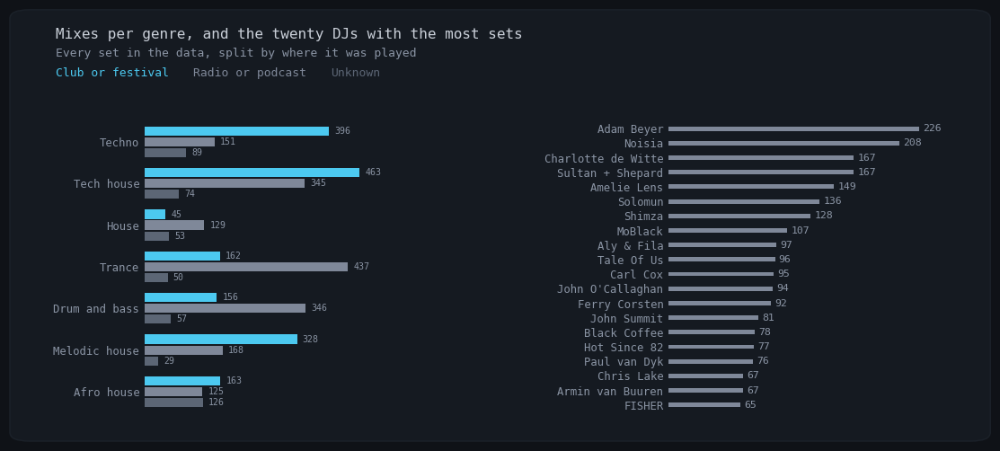

# AI DJ

Builds a beat-matched stereo DJ mix from a genre, a BPM range and an energy curve.

```
real DJ mixes → measured tracks and transitions → pair model → set plan
→ full audio fetched and verified → mixed .flac or .mp3
```

## Data

| Genre | Mixes | DJs | Tracks | Measured transitions |
|---|---:|---:|---:|---:|
| Tech house | 903 | 170 | 8,889 | 2,585 |
| Trance | 652 | 65 | 6,816 | 751 |
| Techno | 643 | 29 | 5,838 | 1,187 |
| Drum and bass | 564 | 99 | 7,194 | 777 |
| Melodic house | 526 | 10 | 3,739 | 271 |
| Afro house | 414 | 9 | 2,981 | 156 |
| House | 235 | 116 | 2,155 | 1,004 |
| **All** | **3,937** | **482** | **37,612** | **6,731** |



## Pipeline

- **Data.** Three sources: 1001tracklists, the Raveform dataset and the DJ data pipeline
  (`djdata_package/`), which finds each track inside real DJ mixes and measures every transition.
- **Planner.** The pair model scores which track should come next, given the set so far. A beam
  search orders the set along the energy curve. On 58 DJs it never trained on, the real next track
  is in its top 10 of 100 for 65 % of pairs.
- **Fetcher.** Copies held tracks from disk or S3 and downloads the rest from YouTube. A download is
  kept only when its fingerprint matches the track's own preview.
- **Mixer.** Plays a phrase-aligned section of each track, picks a transition type, aligns the beats
  at every transition and renders in stereo at −14 LUFS.

## Quick start

```bash
conda activate aidj

# plan, fetch and render in one command
python -m scripts.make_mix --genre techno --bpm 126 132 --curve chill --n 6 \
    --minutes 20 --audio full --out mix.flac
```

Each stage also runs alone: `src.models.predict_model`, `src.data.track_fetcher`,
`src.audio.audio_mixer`.

## Not built yet

- A natural-language prompt and an API
- Transition types, play length and cue points learned from the measured mixes
- DJ style profiles and a club or radio setting

## Docs

`START_HERE.md` is the index. It points to the file for each stage.

## Stack

PyTorch, discogs-effnet, librosa, essentia, rubberband, ffmpeg, Airflow, S3.
